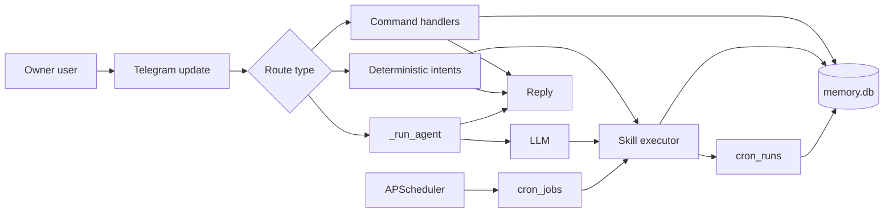

# XoBop

Owner-scoped Telegram copilot with deterministic command routing, SQLite memory, and DB-backed cron jobs.

## Current status

- ✅ Runtime DB name is `memory.db` (no `_v5` naming in active config/code/docs)
- ✅ Owner-only command surface
- ✅ Runtime prompts stored in DB (`strict` / `normal`)
- ✅ Command routing hardening (`/exec`, direct shell intents, cron list intent)
- ✅ Interactive smoke verification (`scripts/smoke_watch.py`)
- ⚠️ Important: do **not** back up a live SQLite DB with plain `cp`

---

## Features

- Telegram bot with owner gate (`OWNER_ID`)
- Two runtime modes: `strict`, `normal`
- Runtime prompt control:
  - `/promptshow`
  - `/promptset <mode> <text|reset>`
- Hybrid memory in SQLite:
  - chat transcript
  - semantic memory + vectors
- Skill/tool execution with policy checks
- DB-backed cron scheduler (APScheduler + `cron_jobs`/`cron_runs`)

---

## Requirements

- Python 3.11+
- Telegram bot token
- OpenAI API key

Install:

```bash
cd xobops-test
python3 -m venv .venv
source .venv/bin/activate
pip install -U pip
pip install -r requirements.txt
cp .env.example .env
# set TELEGRAM_TOKEN, OPENAI_API_KEY, OWNER_ID
./run_test.sh
```

---

## Configuration (`.env`)

Required:

- `TELEGRAM_TOKEN`
- `OPENAI_API_KEY`
- `OWNER_ID`

Defaults:

- `DB_FILE=memory.db`
- `MODEL=gpt-4.1-mini`
- `EMBEDDING_MODEL=text-embedding-3-small`
- `DEFAULT_MODE=strict`
- `ALLOW_RAW_SHELL=0`

---

## Project structure

```text
xobops-test/
├── XoBop.py                 # Main runtime
├── run_test.sh              # Launcher
├── .env                     # Secrets (ignored)
├── .env.example             # Template
├── requirements.txt
├── memory.db                # Runtime DB (ignored)
├── memory.db-shm/.wal       # SQLite runtime files (ignored)
├── scripts/
│   ├── smoke_watch.py       # Interactive smoke verifier
│   └── smoke_test.sh        # Wrapper for smoke_watch
├── artifacts/               # Runtime artifacts (ignored)
├── backups/                 # DB backups (ignored)
└── memory/                  # File memory notes (ignored)
```

---

## Database structure (`memory.db`)

Primary tables used by runtime:

- `conversations` — chat transcript (`chat_id`, `role`, `content`, `timestamp`)
- `memory_items` — semantic memory entries (`text`, `mem_type`, `importance`, `source`, `pinned`, `is_deleted`)
- `memory_vectors` — embedding vectors linked to `memory_items`
- `settings` — runtime settings (e.g., active mode)
- `runtime_prompts` — prompt text per mode (`strict`, `normal`)
- `global_policies` — safety/limits config
- `skills` — enabled skill registry + metadata
- `skill_policies` — per-skill policy overrides
- `runs` — tool execution logs
- `tasks` — open/closed task tracking
- `cron_jobs` — scheduled jobs (`name`, `cron_expr`, `skill_type`, `skill_args`, state)
- `cron_runs` — cron execution history
- `rate_events` — rate-limit accounting buckets

Quick schema inspection:

```bash
python3 - <<'PY'
import sqlite3
con=sqlite3.connect('/home/xavi/.openclaw/workspace/xobops-test/memory.db')
for row in con.execute("SELECT name FROM sqlite_master WHERE type='table' ORDER BY name"):
    print(row[0])
con.close()
PY
```

---

## Runtime flow

1. Telegram update arrives
2. Owner check
3. Routing:
   - command handlers (`/status`, `/cron*`, `/prompt*`, etc.)
   - deterministic intent shortcuts (cron list, direct shell intents)
   - fallback to `_run_agent()` for general chat/tool loop
4. Persistence in `memory.db`
5. Scheduler runs `cron_jobs`, writes `cron_runs`

---

## Commands (core)

- `/status`
- `/mode strict|normal`
- `/promptshow`
- `/promptset strict|normal <text|reset>`
- `/skills`
- `/exec <command>`
- `/cronadd ...`
- `/cronlist`
- `/cronrun <name>`
- `/cronruns <name> [limit]`

---

## Smoke testing

Run:

```bash
cd /home/xavi/.openclaw/workspace/xobops-test
./scripts/smoke_test.sh
```

This launches an interactive verifier and asks you to send test commands in Telegram, then validates replies via DB.

---

## Backup safety (critical)

Do **not** use `cp memory.db ...` while bot is running.

Use SQLite-safe backup methods (`sqlite3 .backup` or Python `sqlite3.Connection.backup`) to avoid corruption.

---

## Architecture diagram


