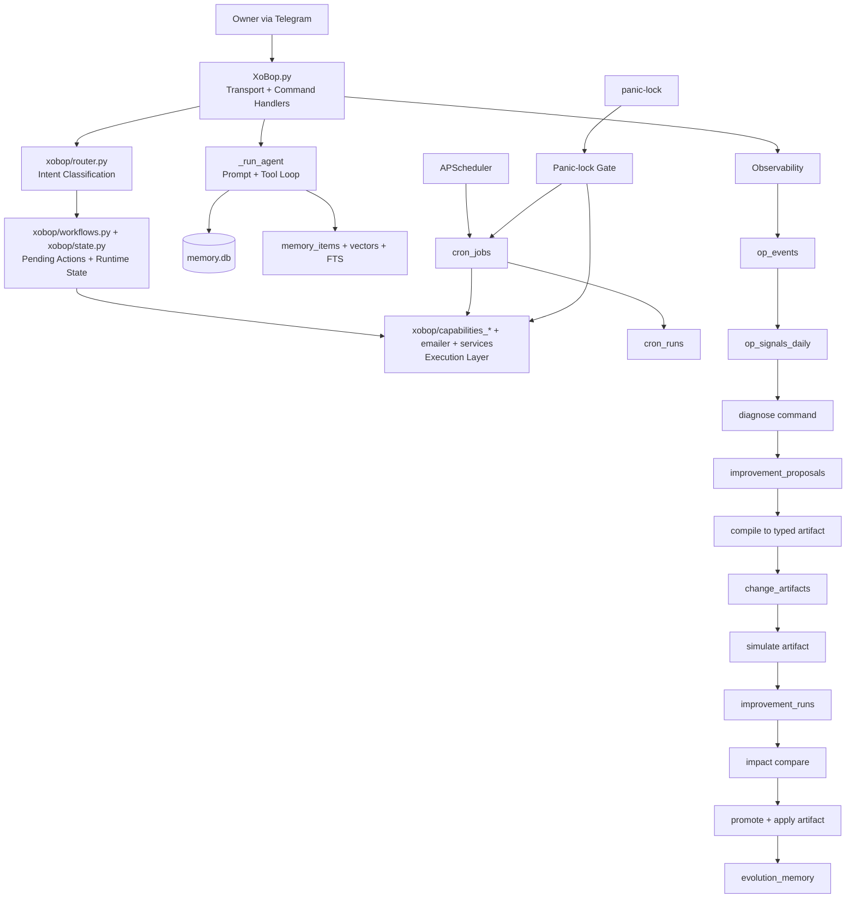

# XoBop

XoBop is an owner-only Telegram operations copilot designed for **deterministic control first** and **self-improvement by measured evidence**.

It is not a generic chatbot. It is a local sovereign ops system with:
- strict safety rails,
- mode-gated autonomy,
- auditable execution,
- and a closed-loop improvement pipeline.

---

## Core Principles

1. **Deterministic-first execution**
   - command handlers / routing / workflows are preferred over freeform LLM behavior.
2. **Owner-only control surface**
   - privileged commands are restricted to `OWNER_ID`.
3. **Safety over convenience**
   - destructive shell patterns are hard-blocked.
4. **Measured improvement only**
   - proposals are generated from telemetry, simulated, compared, then promoted by policy.

---

## System Architecture



---

## Self-Improvement Loop (v1)

XoBop now implements the ordered loop:

1. **Instrumentation** (`op_events`)
2. **Friction metrics** (`op_signals_daily`)
3. **Diagnosis** (`/diagnose`)
4. **Proposal generation** (`/improve_propose`)
5. **Compile to change artifact** (`/improve_compile`, `change_artifacts`)
6. **Simulation gate** (`/improve_simulate`)
7. **Impact comparison** (`/improve_compare`)
8. **Autonomy policy + controlled apply** (`/improve_policy`, `/improve_promote`, `/improve_autopromote`)
9. **Evolution memory** (`/evolve_capture`, `/evolve_memory`)

This creates a closed loop:
**observe → diagnose → propose → simulate → compare → promote safely → remember lesson**

---

## Execution Modes

- `strict` — deterministic/manual operations, minimal autonomy
- `normal` — balanced assistant mode with controlled proactive behavior
- `overseer` — autonomous layer enabled for selected features

Mode setting:
- `/mode`

---

## Safety & Security

### Shell safety
- Hard-blocks destructive patterns (`rm -rf /`, `mkfs`, `dd if=`, `shutdown`, `reboot`, `poweroff`)
- Raw shell is policy-gated (`ALLOW_RAW_SHELL`)
- Write-like path checks enforce root boundaries unless forced

### Panic-lock (Kill-Switch v1, non-destructive)
- `/panicstatus`
- `/paniclock arm`
- `/paniclock confirm <token>` (time-limited second step)
- `/panicunlock <code>` (requires `PANIC_UNLOCK_CODE`)

When panic-lock is ON:
- execution skills are blocked,
- cron execution/mutation paths are blocked or skipped,
- only safety/diagnostic commands are allowed.

---

## Health, Drift, and Diagnostics

### `/health`
Provides:
- DB and workload stats
- task counts
- cron tail
- latency/error summaries
- **System Pulse** (disk/memory/load/temperature)

### `/checkup`
Dependency/env drift check with pinned project interpreter context:
- env presence
- `pip check`
- runtime code path + git revision
- system pulse checks

### `/state_check`
Compares canonical runtime snapshot vs DB/settings state and reports drift.

### `/state_repair`
Repairs DB/settings from canonical runtime snapshot.

### `/diagnose [days]`
Operational diagnosis based on telemetry:
- event/failure summary
- top failing routes
- top unknown commands
- likely-cause hints

---

## Improvement Commands

### Proposal lifecycle
- `/improve_propose [days]` — create proposal from diagnostics
- `/improve_list` — list proposals
- `/improve_compile <proposal_id>` — compile proposal into typed change artifact
- `/improve_artifacts [proposal_id]` — list compiled/applied artifacts
- `/improve_simulate <proposal_id>` — run simulation gate on compiled artifact
- `/improve_runs [proposal_id]` — list simulation/impact/promotion runs
- `/improve_compare <proposal_id> [window_days]` — before/after metrics (anchored to artifact deployment when available)
- `/improve_funnel [days]` — end-to-end improvement funnel metrics
- `/improve_eval_report [days]` — consolidated experiment/evaluation report
- `/improve_weekly_report [weeks]` — weekly controlled-live trend report
- `/improve_phase [baseline|improving]` — baseline vs self-improving trial phase
- `/improve_log_rollback <artifact_id> <reason>` — rollback telemetry logging

### Promotion policy
- `/improve_policy [manual|assisted|auto_low]`
- `/improve_promote <proposal_id> [force]`
- `/improve_autopromote`
- In `baseline` eval phase, promotion is blocked unless forced (for controlled comparison).

### Evolution memory
- `/evolve_capture <proposal_id>`
- `/evolve_memory [limit]`

---

## Additional Core Commands

- `/status`
- `/help`
- `/exec <command>`
- `/clearctx`
- `/topskills`
- `/state_check`
- `/state_repair`

### Cron
- `/cronadd name | schedule | skill_type | description | args_json`
- `/cronrm <name>`
- `/cronlist`
- `/cronon <name>`
- `/cronoff <name>`
- `/cronrun <name>`
- `/cronruns <name> [limit]`

### Quiet hours
- `/quiethours HH:MM-HH:MM`
- `/quietoff`
- `/quietflush`

---

## Requirements

- Python 3.11+
- Telegram bot token
- OpenAI API key
- Optional Gmail app password (email workflows)

---

## Setup

```bash
cd /home/xavi/.openclaw/workspace/xobops-test
python3 -m venv .venv
source .venv/bin/activate
pip install -U pip
pip install -r requirements.txt
cp .env.example .env
./run_test.sh
```

> `run_test.sh` is the runtime launcher.

---

## Key Environment Variables

Required:
- `TELEGRAM_TOKEN`
- `OPENAI_API_KEY`
- `OWNER_ID`

Important:
- `DB_FILE=memory.db`
- `DEFAULT_MODE=strict`
- `MODEL=gpt-4.1-mini`
- `EMBEDDING_MODEL=text-embedding-3-small`
- `ALLOW_RAW_SHELL=0`
- `USE_CAPABILITY_FACADE_SHELL=0` (migration flag; set to `1` to enable shell facade path)
- `USE_SHELL_REPLAY_CONTROLLER=0` (set to `1` to enable shell-only isolated replay in simulation)
- `PANIC_UNLOCK_CODE=<high_entropy_secret>`
- `SELF_MODS_FILE=/home/xavi/.openclaw/workspace/xobops-test/config/self_mods.json`
- `RUNTIME_SNAPSHOT_FILE=/home/xavi/.openclaw/workspace/xobops-test/state/runtime_settings_snapshot.json`
- `ALLOWED_WRITE_ROOT=/home/xavi/.openclaw/workspace/xobops-test`
- `READ_ROOT=/home/xavi/.openclaw/workspace/xobops-test`

---

## Project Layout

```text
xobops-test/
├── XoBop.py
├── xobop/
│   ├── router.py
│   ├── state.py
│   ├── db.py
│   ├── intents.py
│   ├── workflows.py
│   ├── emailer.py
│   ├── capabilities_fs.py
│   ├── capabilities_shell.py
│   ├── services.py
│   ├── shell_facade.py
│   ├── handlers_runtime.py
│   └── simulation/
│       ├── manifest.py
│       ├── temp_db.py
│       ├── golden_traces.py
│       └── replay_controller.py
├── scripts/
│   ├── smoke_test.sh
│   ├── smoke_watch.py
│   ├── eval_suite.py
│   └── build_signals.py
├── config/
│   └── self_mods.json
├── state/
│   └── runtime_settings_snapshot.json
├── artifacts/
├── backups/
├── memory/
├── .env
├── .env.example
├── run_test.sh
└── memory.db
```

---

## Validation Workflows

### Smoke path
```bash
./scripts/smoke_test.sh
```

### Security regression suite
```bash
.venv/bin/python scripts/eval_suite.py
```

### Friction signal materialization
```bash
.venv/bin/python scripts/build_signals.py
```

---

## Backup Safety

Do not copy live SQLite with plain `cp`.
Use SQLite online backup (`sqlite3.Connection.backup`) / provided backup flow.

---

## Current Maturity Snapshot

- Deterministic ops control plane: ✅
- Mode-gated autonomy: ✅
- Shell safety hardening: ✅
- Drift + system pulse diagnostics: ✅
- Unknown command feedback path: ✅
- Closed-loop self-improvement pipeline (A→H): ✅

XoBop is now a **high-trust sovereign ops hub** with explicit, testable improvement mechanics.
