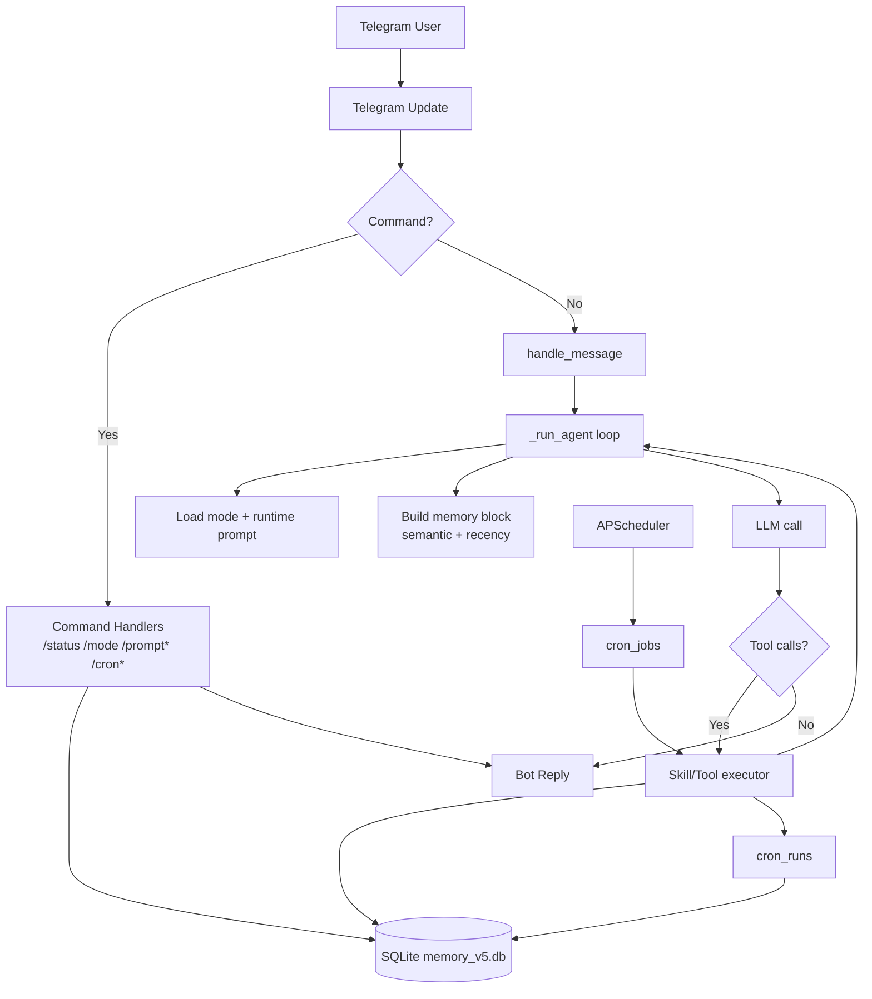

# XoBop

Personal Telegram copilot with memory, skills, and cron automation.

## Features

- Owner-only Telegram bot control
- Two runtime modes (`strict`, `normal`) with DB-backed runtime prompts
- Long-term memory in SQLite (`memory_v5.db`) + embeddings
- Skills/tool execution with policy gates
- Cron jobs stored in DB and executed by APScheduler
- Gmail helper workflow scripts (noise filtering + sender triage)

## Requirements

- Python 3.11+
- Telegram bot token
- OpenAI API key

## Quick install

```bash
cd xobops-test
python3 -m venv .venv
source .venv/bin/activate
pip install -U pip
pip install -r requirements.txt
cp .env.example .env
# edit .env and set TELEGRAM_TOKEN + OPENAI_API_KEY + OWNER_ID
./run_test.sh
```

## Configuration

Main file: `.env`

Required:
- `TELEGRAM_TOKEN`
- `OPENAI_API_KEY`
- `OWNER_ID`

Important optional:
- `MODEL` (default: `gpt-4.1-mini`)
- `EMBEDDING_MODEL` (default: `text-embedding-3-small`)
- `DEFAULT_MODE` (`strict` or `normal`)
- `ALLOW_RAW_SHELL` (`0` recommended)

## Telegram command examples

- `/status`
- `/mode strict`
- `/mode normal`
- `/promptshow`
- `/promptset normal You are concise and practical.`
- `/cronlist`
- `/cronrun <job_name>`

## Notes

- Keep `.env`, database files, and backups out of git.
- Cron command parsing is strict for JSON payloads; keep `/cronadd ... | {json}` on one line.
- For production, run under systemd/tmux and rotate backups.

## Project layout

- `XoBop.py` — main bot runtime
- `run_test.sh` — local launcher
- `.env.example` — config template
- `memory_v5.db` — runtime DB (ignored)
- `artifacts/`, `backups/`, `memory/` — runtime state (ignored)

## Runtime structure (how XoBop works)

```text
xobops-test/
├── XoBop.py                 # Main Telegram bot runtime (commands, agent loop, cron)
├── run_test.sh              # Local launcher (loads .env, activates venv, starts bot)
├── .env                     # Secrets/config (ignored in git)
├── .env.example             # Safe template for required env vars
├── requirements.txt         # Python dependencies
├── memory_v5.db             # Main SQLite state DB (ignored)
├── memory_v5.db-shm/.wal    # SQLite runtime files (ignored)
├── artifacts/               # Generated artifacts from tool/skill runs (ignored)
├── backups/                 # DB backups (ignored)
└── memory/                  # File-based daily/long notes (ignored)
```

## Execution flow

1. Telegram message arrives to bot.
2. Owner check is applied.
3. Command path:
   - `/status`, `/mode`, `/promptshow`, `/cron*`, etc. handled directly.
4. Free-text path:
   - `_run_agent()` builds prompt + memory block + recent history.
   - LLM may call skills/tools.
   - Tool results are appended and finalized into assistant response.
5. Persistence:
   - Conversations + memories + cron jobs/runs are stored in `memory_v5.db`.
6. Scheduler:
   - APScheduler loads DB cron jobs at startup and executes them on schedule.

## Core loop details

### 1) Input + routing
- Telegram updates are received by `python-telegram-bot` handlers.
- If message starts with a registered command (`/status`, `/cronrun`, etc.), command handlers run.
- Otherwise message goes to `handle_message()` and enters agent loop.

### 2) Agent loop (`_run_agent`)
- Select mode: `strict` or `normal` (from settings table).
- Fetch runtime prompt from `runtime_prompts` table.
- Build memory context block from semantic memory retrieval.
- Build message stack: system prompt + recent chat history + user message.
- Call LLM.
- If tool calls are returned:
  - validate/parse args
  - execute mapped skill/tool
  - append tool output
  - loop again until final assistant answer or max rounds

### 3) Memory model
XoBop uses hybrid memory:
- **Conversation memory**: `conversations` table (chat transcript)
- **Semantic memory**: `memory_items` + `memory_vectors`
- **Settings/policies**: `settings`, `global_policies`, `runtime_prompts`
- **Tasks**: `tasks`
- **Cron**: `cron_jobs`, `cron_runs`

Memory retrieval combines similarity + recency; important user facts can be pinned.

### 4) Prompt/SOUL/skills relationship
- **SOUL (behavior identity):** implemented in runtime prompt text (strict/normal modes in DB).
- **Memory:** provides user/context continuity injected at runtime.
- **Skills:** executable capabilities exposed to the LLM as tools.
- **Policy gates:** enforce owner-only control + risk boundaries before side effects.

## Architecture diagram


