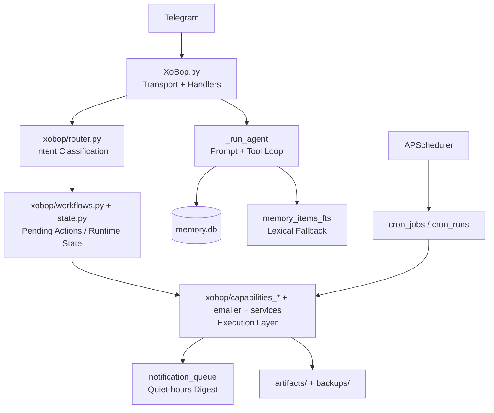

# XoBop

XoBop is an owner-only Telegram copilot for local operations.
It is designed for **deterministic execution first** (commands/workflows/router), with LLM fallback only when structured routes do not apply.
State, memory, prompts, and cron metadata are persisted in SQLite (`memory.db`).

---

## What it is

- A personal operations assistant (single-owner)
- A memory-backed executor with policy gates
- A Telegram-native control plane for shell/file/cron/email workflows

## What it does

- Executes operational commands through controlled capabilities
- Manages facts/tasks/memory and semantic retrieval context
- Runs DB-backed cron jobs and records execution history (includes default `db-backup-6h`, `prompt-review-weekly`, `checkup-monthly`, and `system-map-weekly` jobs)
- Handles attachment-aware email workflow (with Gmail env configured)
- Supports quiet-hours queueing for non-urgent notifications with digest flush
- Persists pending actions and restores them after restart
- Enforces hard shell blacklist for destructive command patterns
- Exposes expanded `/health` metrics (DB size, tasks, last cron statuses, OpenAI latency)
- Adds host System Pulse in `/health` and `/checkup` (disk/memory/load/temperature status)
- Adds `/checkup` drift diagnostics and plan-then-execute (`/plan` + `/go`) workflow
- Auto-refreshes `memory/SYSTEM_MAP.md` weekly via cron

## What it does **not** do

- Multi-user role-based access control (owner-only model)
- Guaranteed enterprise-grade migration tooling for all legacy DB variants
- Arbitrary unrestricted shell (raw shell remains policy-gated)
- External cloud orchestration beyond configured local/runtime capabilities

---

## Execution modes

| Mode | Intent |
|---|---|
| `strict` | deterministic/manual operation, minimal autonomy |
| `normal` | balanced assistant mode with controlled proactive features |
| `overseer` | autonomous layer enabled (multimodal artifact indexing, autonomous review jobs) |

Overseer-only behaviors are gated by mode checks to prevent agentic drift in strict/manual workflows.

---

## Requirements

- Python 3.11+
- Telegram bot token
- OpenAI API key
- Optional for email workflows:
  - Gmail account with app password

Install:

```bash
cd xobops-test
python3 -m venv .venv
source .venv/bin/activate
pip install -U pip
pip install -r requirements.txt
cp .env.example .env
./run_test.sh
```

> `run_test.sh` is the runtime launcher (legacy name), not a unit-test runner.

---

## Configuration

Required:

- `TELEGRAM_TOKEN`
- `OPENAI_API_KEY`
- `OWNER_ID`

Important options:

- `DB_FILE=memory.db`
- `DEFAULT_MODE=strict`
- `MODEL=gpt-4.1-mini`
- `EMBEDDING_MODEL=text-embedding-3-small`
- `ALLOW_RAW_SHELL=0`
- `PANIC_UNLOCK_CODE=<high_entropy_secret>`
- `ALLOWED_WRITE_ROOT=/home/xavi/.openclaw/workspace/xobops-test`
- `READ_ROOT=/home/xavi/.openclaw/workspace/xobops-test`
- `GMAIL_EMAIL=...` (optional)
- `GMAIL_APP_PASSWORD=...` (optional)

### `.env.example`

```env
TELEGRAM_TOKEN=your_telegram_bot_token
OPENAI_API_KEY=your_openai_key
OWNER_ID=5410368885
GMAIL_EMAIL=your_gmail_address@gmail.com
GMAIL_APP_PASSWORD=your_16_char_google_app_password
MODEL=gpt-4.1-mini
EMBEDDING_MODEL=text-embedding-3-small
DB_FILE=memory.db
DEFAULT_MODE=strict
ARTIFACT_DIR=artifacts
ALLOWED_WRITE_ROOT=/home/xavi/.openclaw/workspace/xobops-test
READ_ROOT=/home/xavi/.openclaw/workspace/xobops-test
ALLOW_RAW_SHELL=0
EMBEDDING_FALLBACK=1
FILE_MEMORY_ROOT=/home/xavi/.openclaw/workspace/xobops-test
LONG_MEMORY_FILE=/home/xavi/.openclaw/workspace/xobops-test/MEMORY.md
DAILY_MEMORY_DIR=/home/xavi/.openclaw/workspace/xobops-test/memory
```

---

## Architecture

### System diagram



### Layers

1. **Transport** (`XoBop.py`)
   - Telegram app wiring, handlers registration, lifecycle hooks
2. **Routing** (`xobop/router.py`)
   - Unified action classification (command-like intents)
3. **Workflow** (`xobop/workflows.py`, `xobop/state.py`)
   - Pending action progression and runtime state
4. **Capabilities** (`xobop/capabilities_*.py`, `xobop/emailer.py`, `xobop/services.py`)
   - Executable operations and adapters
5. **Agent loop** (`_run_agent`)
   - Prompt assembly, memory injection, tool loop
6. **Persistence/Scheduling** (`memory.db`, APScheduler)
   - Durable state, cron jobs, run logs, queues

### Memory read path

Per turn in `_run_agent`:
- build query from current user text + up to the last 3 user turns
- retrieve top-3 semantic memories from `memory_items` + `memory_vectors`
- inject retrieved memories into prompt context
- if embedding path degrades, SQLite FTS5 lexical fallback retrieval is used

---

## Project structure

```text
xobops-test/
├── XoBop.py
├── xobop/
│   ├── router.py
│   ├── state.py
│   ├── db.py
│   ├── intents.py
│   ├── workflows.py
│   ├── emailer.py
│   ├── capabilities_fs.py
│   ├── capabilities_shell.py
│   ├── services.py
│   └── handlers_runtime.py
├── .env
├── .env.example
├── .gitignore
├── run_test.sh
├── requirements.txt
├── memory.db
├── scripts/
│   ├── smoke_watch.py
│   └── smoke_test.sh
├── artifacts/
├── backups/
└── memory/
```

---

## Database highlights

Main tables:
- `conversations`, `facts`, `tasks`, `settings`
- `memory_items`, `memory_vectors`
- `skills`, `skill_policies`, `skill_usage_stats`, `skill_audit`
- `runs`, `cron_jobs`, `cron_runs`
- `global_policies`, `runtime_prompts`, `rate_events`
- `sessions` (state hydration)
- `notification_queue` (quiet-hours queue)

Quick schema check:

```bash
python3 - <<'PY'
import sqlite3
con=sqlite3.connect('./memory.db')
for row in con.execute("SELECT name FROM sqlite_master WHERE type='table' ORDER BY name"):
    print(row[0])
con.close()
PY
```

Migration note:
- Fresh DB is auto-initialized at startup.
- Legacy DB upgrades should be tested on a copy first.

---

## Commands

Core:
- `/status`, `/health`, `/checkup`, `/diagnose [days]`, `/improve_propose [days]`, `/improve_list`, `/improve_simulate <id>`, `/improve_runs [id]`, `/improve_compare <id> [days]`, `/improve_policy [manual|assisted|auto_low]`, `/improve_promote <id> [force]`, `/improve_autopromote`, `/help`
- `/mode`, `/promptshow`, `/promptset`, `/plan`, `/go`
- `/promptproposal`, `/promptapprove`, `/promptreject`
- `/exec`
- `/panicstatus`, `/paniclock arm|confirm <token>`, `/panicunlock <code>`
- `/cronadd`, `/cronlist`, `/cronrun`, `/cronruns`, `/cronon`, `/cronoff`, `/cronrm`

Memory/tasks/skills:
- `/remember`, `/delfact`, `/facts`
- `/memories`, `/memadd`, `/memdel`
- `/addtask`, `/donetask`, `/tasks`
- `/skills`, `/skillon`, `/skilloff`, `/clearctx`

Quiet hours:
- `/quiethours HH:MM-HH:MM`
- `/quietoff`
- `/quietflush`

Use `/help` for current runtime command text.

---

## Smoke testing

```bash
cd /home/xavi/.openclaw/workspace/xobops-test
./scripts/smoke_test.sh
```

- Interactive verifier asks you to send test prompts in Telegram
- It validates expected replies from DB traces
- **PASS** => all checks matched
- **FAIL** => step + reason reported

## Security regression evals (Phase 9)

```bash
cd /home/xavi/.openclaw/workspace/xobops-test
.venv/bin/python scripts/eval_suite.py
```

Current suite validates:
- deterministic router intent classification for core intents
- hard destructive shell blacklist enforcement
- force-gate behavior
- shell allowlist enforcement
- write-root boundary gate enforcement

## Ops instrumentation + friction signals (Sprint A)

```bash
cd /home/xavi/.openclaw/workspace/xobops-test
.venv/bin/python scripts/build_signals.py
```

This materializes daily metrics in `op_signals_daily` from `op_events`:
- total events
- failures
- unknown command count
- retries total
- median / p95 latency

---

## Backup safety (critical)

Do **not** copy a live SQLite DB with plain `cp`.
Use SQLite online backup API / `.backup`.

XoBop includes `db_backup` cron skill for safe online backups.
Backup filenames include UTC timestamp and git short hash when available.
