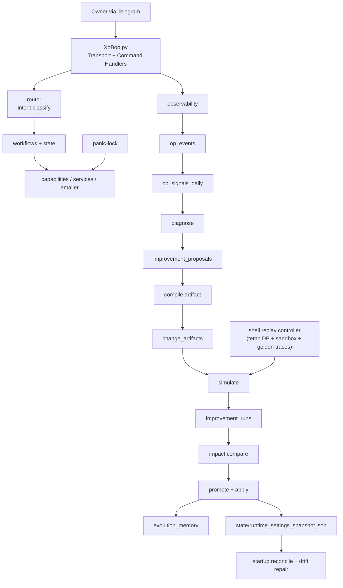

# XoBop

XoBop is an owner-only Telegram operations copilot focused on:

- deterministic operations
- bounded self-modification
- isolated simulation
- reproducible runtime state
- measurable improvement over time

This repo now includes a full constrained self-improvement loop from instrumentation to controlled promotion and evaluation reporting.

---

## Current Status (Implemented)

### Core runtime
- Owner-only control surface (`OWNER_ID`)
- Mode-gated behavior (`strict`, `normal`, `overseer`)
- Deterministic command routing + fallback command handling
- Panic-lock safety mode with 2-step arm/confirm and unlock code

### Safety and shell controls
- Hard-block destructive shell patterns
- Allowlist / policy-gated shell execution
- Write-root and read-root boundary enforcement
- Shell capability facade migration (feature-flagged)

### Memory + diagnostics
- Semantic + lexical memory support
- `/health` with system pulse (disk/memory/load/temp)
- `/checkup` drift diagnostics pinned to project interpreter

### Self-improvement pipeline (A→K)
- A: instrumentation (`op_events`) + friction signals (`op_signals_daily`)
- B: diagnosis (`/diagnose`)
- C: proposal generation (`/improve_propose`)
- D: simulation gate (`/improve_simulate`)
- E: impact comparison (`/improve_compare`)
- F: controlled autonomy policy (`/improve_policy`, promote gates)
- G: evolution memory (`/evolve_capture`, `/evolve_memory`)
- H: typed change artifacts + apply-on-promotion bridge
- I: canonical runtime snapshot + startup reconciliation + drift repair
- J: evaluation layer (funnel, per-case persistence, eval report)
- K: controlled live-eval phase + weekly reporting + rollback telemetry

---

## Architecture



---

## Commands

## Core
- `/help`
- `/status`
- `/health`
- `/checkup`
- `/state_check`
- `/state_repair`
- `/op_sanity [hours]`
- `/mode [strict|normal|overseer]`
- `/exec <command>`
- `/clearctx`

## Improvement lifecycle
- `/diagnose [days]`
- `/improve_propose [days]`
- `/improve_list`
- `/improve_compile <proposal_id>`
- `/improve_artifacts [proposal_id]`
- `/improve_simulate <proposal_id>`
- `/improve_runs [proposal_id]`
- `/improve_compare <proposal_id> [window_days]`

## Promotion / autonomy policy
- `/improve_policy [manual|assisted|auto_low]`
- `/improve_promote <proposal_id> [force <reason>]`
- `/improve_autopromote`

## Evaluation (Sprint J/K)
- `/improve_funnel [days]`
- `/improve_eval_report [days]`
- `/improve_weekly_report [weeks]`
- `/improve_phase [baseline|improving]`
- `/improve_log_rollback <artifact_id> <reason>`

## Evolution memory
- `/evolve_capture <proposal_id>`
- `/evolve_memory [limit]`

## Cron
- `/cronadd name | schedule | skill_type | description | args_json`
- `/cronrm <name>`
- `/cronlist`
- `/cronon <name>`
- `/cronoff <name>`
- `/cronrun <name>`
- `/cronruns <name> [limit]`

## Quiet hours
- `/quiethours HH:MM-HH:MM`
- `/quietoff`
- `/quietflush`

## Panic-lock
- `/panicstatus`
- `/paniclock arm`
- `/paniclock confirm <token>`
- `/panicunlock <code>`

---

## Self-Modification Scope (currently allowed)

Allowed artifact families (frozen for controlled trial):
- `alias` (routing alias rules)
- `retry` (runtime retry policy)

Not allowed (by design for now):
- arbitrary code diffs
- auth / shell safety core policy mutation
- DB schema self-mutation
- deployment pipeline self-mutation

---

## Reproducibility and State Control

Canonical tracked runtime state:
- `state/runtime_settings_snapshot.json`

Flow on artifact apply:
1. apply artifact to runtime settings
2. export deterministic snapshot
3. commit snapshot in git
4. store commit hash on artifact
5. mark artifact applied

Startup reconciliation:
- snapshot loaded at boot
- drift detected vs DB/settings
- DB/settings repaired from snapshot if needed

Commands:
- `/state_check`
- `/state_repair`

---

## Simulation Safety (Shell SSE v1)

Implemented:
- shell capability facade (`live`/`simulate` backends)
- shell replay controller with:
  - temp DB fork (SQLite backup API)
  - sandbox root
  - targeted replay cases
  - golden traces
  - side-effect intent manifest
  - pass/fail report integration into simulation run

Feature flags:
- `USE_CAPABILITY_FACADE_SHELL=0|1`
- `USE_SHELL_REPLAY_CONTROLLER=0|1`

---

## Evaluation and Trial Discipline

Controlled live evaluation phase:
- `baseline` (promotion blocked unless forced)
- `improving` (policy-driven promotion)

Primary metric:
- failure rate per 100 commands

Secondary metrics:
- unknown command rate per 100
- actionable proposal rate
- simulation pass rate
- drift repair events
- rollback events

See:
- `EVAL_PLAN.md` (14-day freeze + evidence workflow template)

---

## Environment Variables

Required:
- `TELEGRAM_TOKEN`
- `OPENAI_API_KEY`
- `OWNER_ID`

Important:
- `DB_FILE=memory.db`
- `DEFAULT_MODE=strict`
- `MODEL=gpt-4.1-mini`
- `EMBEDDING_MODEL=text-embedding-3-small`
- `ALLOW_RAW_SHELL=0`
- `USE_CAPABILITY_FACADE_SHELL=0`
- `USE_SHELL_REPLAY_CONTROLLER=0`
- `PANIC_UNLOCK_CODE=<high_entropy_secret>`
- `SELF_MODS_FILE=/home/xavi/.openclaw/workspace/xobops-test/config/self_mods.json`
- `RUNTIME_SNAPSHOT_FILE=/home/xavi/.openclaw/workspace/xobops-test/state/runtime_settings_snapshot.json`
- `ALLOWED_WRITE_ROOT=/home/xavi/.openclaw/workspace/xobops-test`
- `READ_ROOT=/home/xavi/.openclaw/workspace/xobops-test`

---

## Setup

```bash
cd /home/xavi/.openclaw/workspace/xobops-test
python3 -m venv .venv
source .venv/bin/activate
pip install -U pip
pip install -r requirements.txt
cp .env.example .env
./run_test.sh
```

---

## Project Layout

```text
xobops-test/
├── XoBop.py
├── EVAL_PLAN.md
├── xobop/
│   ├── router.py
│   ├── state.py
│   ├── db.py
│   ├── intents.py
│   ├── workflows.py
│   ├── emailer.py
│   ├── capabilities_fs.py
│   ├── capabilities_shell.py
│   ├── services.py
│   ├── shell_facade.py
│   ├── handlers_runtime.py
│   └── simulation/
│       ├── __init__.py
│       ├── manifest.py
│       ├── temp_db.py
│       ├── golden_traces.py
│       └── replay_controller.py
├── scripts/
│   ├── smoke_test.sh
│   ├── smoke_watch.py
│   ├── eval_suite.py
│   └── build_signals.py
├── config/
│   └── self_mods.json
├── state/
│   └── runtime_settings_snapshot.json
├── artifacts/
├── backups/
├── memory/
├── .env
├── .env.example
├── run_test.sh
└── memory.db
```

---

## Validation Commands

Compile:
```bash
python3 -m py_compile XoBop.py xobop/*.py xobop/simulation/*.py scripts/eval_suite.py
```

Eval suite:
```bash
.venv/bin/python scripts/eval_suite.py
```

Build friction signals:
```bash
.venv/bin/python scripts/build_signals.py
```

---

## Notes

- Keep trial scope frozen during evaluation windows.
- Prefer deterministic/reversible changes over aggressive feature expansion.
- For now, evidence quality > feature breadth.
